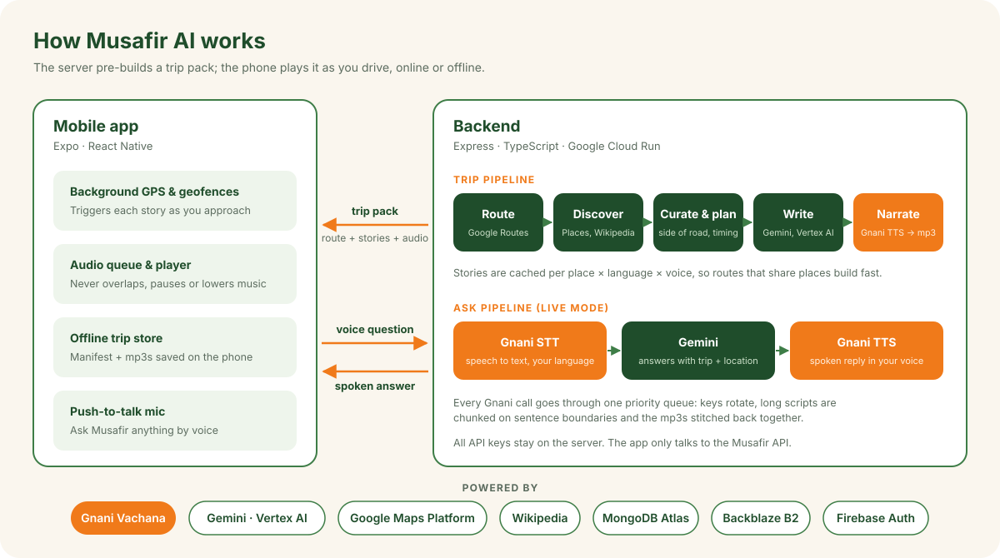

<p align="center">
  
</p>

# Musafir AI

**Google Maps tells you where you are. Musafir tells you the story of where you are.**

Musafir is a voice-first AI road-trip companion, a "Netflix for road trips". Pick where you're going, your
language and a narrator voice, then drive. Musafir follows your GPS and plays short audio stories as you approach
forts, temples, towns, lakes and famous food spots, in your language. Ask it questions by voice along the way.
Download a trip before you leave and it plays with no internet at all.

Built for the Gnani hackathon: **voice and Indian languages are the product.**

<p>
  <a href="https://drive.google.com/file/d/1lLjuxTssInW-RKspIpeNCBblvy0fQ6Ym/view?usp=sharing"><b>⬇️ Download for Android (APK)</b></a> &nbsp;·&nbsp;
  <a href="https://testflight.apple.com/join/MGuPTcPq"><b>🍎 iOS on TestFlight</b></a> &nbsp;·&nbsp;
  <a href="https://www.youtube.com/watch?v=3aWyltIUwaQ"><b>▶️ Demo video</b></a> &nbsp;·&nbsp;
  <a href="https://www.youtube.com/watch?v=w5tXsCebxUE"><b>🎬 Detailed demo</b></a> &nbsp;·&nbsp;
  <a href="https://lnkd.in/p/gbviqd28"><b>💼 LinkedIn post</b></a>
</p>

---

## 🎬 Experience Musafir AI

| | Link |
|---|---|
| 🎥 Demo video | [Watch on YouTube](https://www.youtube.com/watch?v=3aWyltIUwaQ) |
| 🎬 Detailed demo video | [Watch on YouTube](https://www.youtube.com/watch?v=w5tXsCebxUE) |
| 📱 Android app | [Download the APK](https://drive.google.com/file/d/1lLjuxTssInW-RKspIpeNCBblvy0fQ6Ym/view?usp=sharing) |
| 🍎 iOS | [Join the TestFlight beta](https://testflight.apple.com/join/MGuPTcPq) |
| 💻 GitHub repository | [Aryanshettar007/Musafir-AI](https://github.com/Aryanshettar007/Musafir-AI) |
| 💼 LinkedIn | [Read the launch post](https://lnkd.in/p/gbviqd28) |

## Demo

| Demo | Detailed walkthrough |
|---|---|
| [](https://www.youtube.com/watch?v=3aWyltIUwaQ) | [](https://www.youtube.com/watch?v=w5tXsCebxUE) |

## Features

### Stories that follow the road
- **Automatic, GPS-triggered narration.** Each story has a trigger point on the route, placed so the narrator is
  mid-story when the place is closest. Background location keeps it working with the screen off.
- **"On your left" is always right.** Side of the road, distances and timing are computed in code from the route
  geometry, never guessed by the AI.
- **A full trip, not random facts:** a personalised trip intro, town welcomes as you enter towns, single-place
  stories, **episodes** (three or more nearby places told as one connected story), famous local food stops, and
  long-form stories for empty stretches of highway.
- **Local and intercity trips.** A drive across the city and a drive across the state get different rules for
  which places to pick and how to pace them.
- **Grounded in facts.** Facts come from Wikipedia first. Gemini writes the script from those facts and fills in only
  for famous places without an article. Generated text is checked for the correct script (no Telugu letters leaking
  into Kannada), length is controlled per language, and numbers and units are spelled out so the voices pronounce
  them properly.

### Voice and languages
- **11 Indian languages:** English (India), Hindi, Hinglish, Kannada, Tamil, Telugu, Malayalam, Marathi, Bengali,
  Gujarati and Punjabi, all narrated by Gnani Timbre v2.5.
- **42 narrator voices** with a male/female picker, a recommended voice per language, and a ▶ Try sample for every
  voice in your language.
- **Clone your own voice.** Record a short sample (and add a photo) and Musafir narrates your trips in your voice,
  using Gnani's voice cloning.
- **Talk to Musafir (live mode).** Hold the mic button and ask anything: "What is this fort famous for?",
  "Where should we stop for food?" Your speech goes through Gnani speech-to-text, Gemini answers with the context of
  your trip and location, and Gnani speaks the reply.
- **Plays nicely with your music.** Choose whether stories pause your music or just lower it while they play.

### Made for the road
- **Offline trip packs.** The whole trip (route, stories and audio) downloads to the phone with a progress
  indicator. Listens recorded offline sync when you're back online.
- **Personalised.** Onboarding asks for your language, voice, interests (history, forts, temples, food, nature,
  adventure, art, legends, cinema) and music preference. You can change language, voice and mood for any single trip.
- **Trip view:** map with the route and story markers, now-playing card with a scrubber, upcoming stories in a bottom
  sheet, and audio settings.
- **Trip simulator** to drive a route virtually and hear the stories trigger, great for demos without a car.
- **Report a story** if something is wrong.

### Explore
- **Partner experiences.** Sponsored stories from local businesses and brands along your route (for example
  Karnataka Tourism, Corner House and Royal Enfield in the demo), shown on a map with their outlets.
- **Creator packs.** Curated audio trails such as heritage walks and food trails from local storytellers
  (sample content in this build).

### Account
- Google and Apple sign-in through Firebase, in-app account deletion, privacy policy, terms and a support page.
- Light and dark mode.

## How it works

<p align="center">
  
</p>

- **Trip packs.** The server builds the whole trip as a manifest of geo-triggered audio items, so online and offline
  playback are the same code path.
- **Stories are cached per place** (`place × language × voice × prompt version`), so routes that share places build
  quickly once those places have been narrated.
- **Gnani calls go through one priority queue** with rotation across API keys, chunking long scripts on sentence
  boundaries and stitching the mp3s together.
- **All third-party keys for content generation stay on the server.** The app only talks to the Musafir API.

The full design is in [`docs/ARCHITECTURE.md`](docs/ARCHITECTURE.md).

## Repo layout

| Path | What it is |
|---|---|
| [`App/`](App) | Expo / React Native app (Expo Router): screens in `src/app`, UI in `src/components`, API and offline logic in `src/services` |
| [`backend/src/pipeline/`](backend/src/pipeline) | Trip pipeline: discover, match, classify, curate, plan, write. Tunable numbers live in `rules.ts` |
| [`backend/src/speech/`](backend/src/speech) | Narration: chunking, per-language style, script checks, spelling out numbers |
| [`backend/src/services/`](backend/src/services) | Trips, ask (live mode), custom voices, sponsors, reports, users |
| [`backend/src/clients/`](backend/src/clients) | One client per external API: Gnani, Gemini, Maps, Wikipedia, Firebase, Apple, storage |
| [`backend/scripts/`](backend/scripts) | CLI tools: build a trip, ask a question, demo server, voice demos, sponsor seeding, deploy |
| `backend/spikes/` | API experiments, each with a `FINDINGS.md` |
| [`docs/`](docs) | [Architecture](docs/ARCHITECTURE.md), [API reference](docs/API.md), [frontend guide](docs/FRONTEND_GUIDE.md) |
| [`reference/`](reference) | Original idea sketches |

Each folder has its own README: [App](App/README.md), [backend](backend/README.md), [docs](docs/README.md),
[reference](reference/README.md).

## Getting started

### Prerequisites
- Node.js 24
- MongoDB Atlas cluster
- Gnani Vachana API key(s)
- Google Maps Platform key with the Routes API and Places API (New)
- Google Cloud project with Vertex AI enabled, and the `gcloud` CLI
- Firebase project for authentication
- S3-compatible bucket for audio (we use Backblaze B2)

### Backend

```bash
cd backend
npm install
cp .env.example .env                      # fill in the values
gcloud auth application-default login     # Gemini runs on Vertex AI with Application Default Credentials, no API key
npm run dev                               # http://localhost:3000, health check at GET /health
```

| Variable | Purpose |
|---|---|
| `MONGODB_URI` | MongoDB connection string |
| `GNANI_API_KEY1`, `GNANI_API_KEY2`, … | Gnani keys for speech-to-text, text-to-speech and voice cloning (rotated) |
| `GOOGLE_CLOUD_PROJECT`, `GOOGLE_CLOUD_LOCATION` | Vertex AI project for Gemini (location defaults to `global`) |
| `GOOGLE_MAPS_API_KEY` | Routes API and Places API (New) |
| `FIREBASE_PROJECT_ID` | Verifies Firebase ID tokens |
| `STORAGE_DRIVER`, `S3_*` | Audio storage |
| `APPLE_*` | Sign in with Apple |

The full list is in [`backend/.env.example`](backend/.env.example).

### App

```bash
cd App
npm install
cp .env.example .env    # set EXPO_PUBLIC_BACKEND_URL to your computer's LAN IP, e.g. http://192.168.1.10:3000
npm run android         # or: npm run ios
```

Background location needs a development build, not Expo Go. A phone can't reach `localhost` on your computer, so
use its LAN IP. App conventions: [`App/AGENTS.md`](App/AGENTS.md) and [`docs/FRONTEND_GUIDE.md`](docs/FRONTEND_GUIDE.md).

## Useful commands

```bash
# Backend (in backend/)
npm run typecheck     # src + tests
npm test              # Vitest; API tests use an in-memory MongoDB
npm run build         # compile to dist/

npx tsx scripts/build-trip.ts --from "Bengaluru" --to "Mysore Palace" --language kn-IN --voice Girish   # build a real trip
npx tsx scripts/demo/server.ts          # local map + live-mode demo at http://localhost:5050
npx tsx scripts/preview-selection.ts test/fixtures/discovery-blr-mys.json   # tune place selection offline, writes GeoJSON
npx tsx scripts/ask.ts --text "What is Srirangapatna famous for?" --lat 12.4216 --lng 76.6930   # live mode from the CLI

# App (in App/)
npm run lint
npm run build:android                   # EAS production build (also build:ios, build:all)
```

## API

Every endpoint except `GET /health` needs a Firebase ID token (`Authorization: Bearer <token>`). Responses are
`{ success: true, data }` or `{ success: false, error: { code, message } }`.

| Endpoint | Purpose |
|---|---|
| `GET /catalog` | Languages, interests and onboarding options |
| `GET /voices` | Voice catalogue with demo clips, recommended voice first |
| `POST /voices/custom`, `GET /voices/custom`, `DELETE /voices/custom/:id` | Clone, list and delete your own voices |
| `GET/PUT/PATCH/DELETE /me` | Profile and account deletion |
| `GET /places/autocomplete` | Search for the start and destination |
| `POST /trips/preview`, `POST /trips` | Preview the stories on a route, then build the trip pack |
| `GET /trips`, `GET /trips/:id` | Recent trips and a full trip pack |
| `POST /listens` | Record which stories were heard |
| `POST /ask` | Voice question in, spoken answer out |
| `GET /sponsors` | Partner experiences and their outlets |
| `POST /reports`, `GET /reports/my` | Report a problem with a story |

Request and response details: [`docs/API.md`](docs/API.md).

## Deployment

- **Backend:** Google Cloud Run (`asia-south1`). [`backend/scripts/deploy-cloud-run.sh`](backend/scripts/deploy-cloud-run.sh)
  reads `backend/.env`, stores the sensitive values in Secret Manager, sets up a service account with Vertex AI
  access and deploys with [`backend/Dockerfile`](backend/Dockerfile):
  ```bash
  cd backend && bash scripts/deploy-cloud-run.sh
  ```
- **App:** EAS Build for the Android APK / Play Store and iOS TestFlight.

## Tech stack

| Layer | Tech |
|---|---|
| App | Expo SDK 57, React Native, Expo Router, expo-location + TaskManager, expo-audio, react-native-maps, Firebase Auth |
| Backend | Node.js 24, Express, TypeScript (strict), zod, Mongoose, Vitest, ffmpeg |
| Voice | Gnani Vachana: Timbre v2.5 TTS, speech-to-text, voice cloning |
| AI | Gemini (`gemini-3.5-flash-lite`, `gemini-3.8-flash`) on Vertex AI via `@google/genai` |
| Data | Google Maps Routes and Places API (New), Wikipedia |
| Infra | MongoDB Atlas, Backblaze B2, Google Cloud Run, Secret Manager, EAS |

## Built by

- **[Aryan Shettar](https://aryanshettar.tech)**
- **[Rishit Umesh Padagatti](https://www.rishitpadagatti.dev/)**
